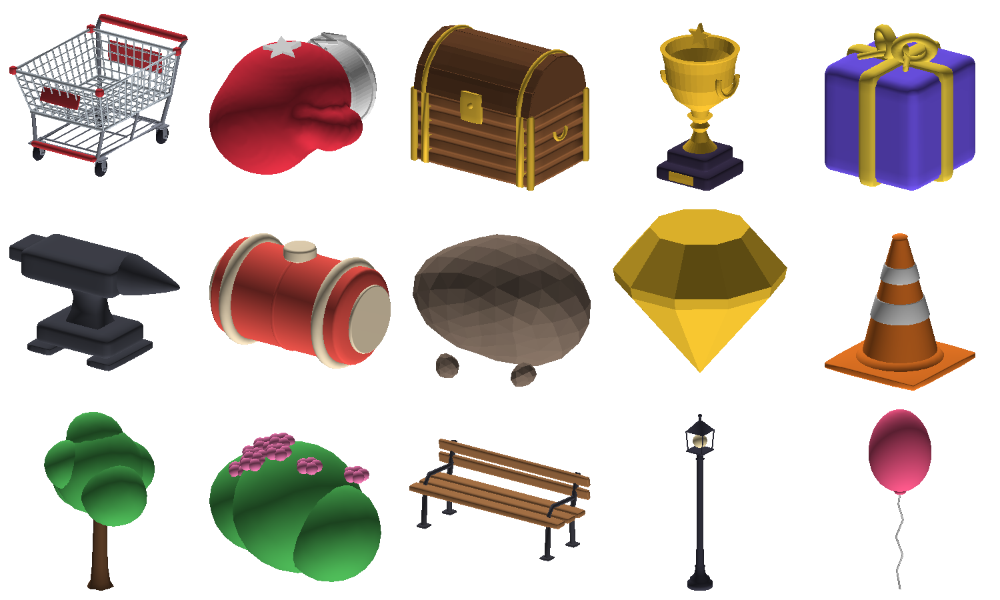

# Meshes and audio

All art props and audio are **original and generated from code**, so there's nothing to license.

| Folder | What | Generator |
| --- | --- | --- |
| `assets/meshes/*.obj, *.glb` | about 400 toy-style props: the lobby's (trophy, trees, lamp posts...) and each arena's own set | `python3 tools/meshgen/generate_meshes.py` (each game's props in `tools/meshgen/props/<Game>.py`) |
| `assets/audio/music/*.ogg` | "Party Plaza" + "Sunset Social" (lobby playlist), "Panic Mode" (rounds) | `python3 tools/music/compose.py` |
| `build/music/packs/ModePack*.ogg` (not in git: rebuilt by `pack`, kept by Roblox once uploaded) | each mini-game's own round song, several to a file | `python3 tools/music/modes.py` |
| `assets/audio/sfx/*.ogg` | 15 sound effects, plus `SfxSprite.ogg` (all of them in one file) | same |

Requirements for regenerating: Python 3.10+, `numpy`, `scipy`, `scikit-image` (meshes; the hats also
need `pyfqmr`), and `ffmpeg` with libvorbis (audio).



## How the game uses them

The game works without uploading anything. Until the assets are uploaded:

- **Props** come from `World/MeshLibrary`'s fallbacks, which are small groups of rounded CSG
  shapes (they look decent but are less detailed).
- **Sound effects** use sounds that ship with the Roblox client.
- **Music** is silent.

After upload, `MeshLibrary` builds one template per prop from the uploaded mesh and clones it
everywhere. Identical MeshParts are GPU-instanced, so a lobby full of trees or a race full of
carts stays cheap on phones.

## Uploading (Open Cloud)

1. Create an Open Cloud API key at <https://create.roblox.com/dashboard/credentials> with the
   **Assets** API (read + write), and export it: `export ROBLOX_API_KEY=...`
2. Find the user or group id that **owns your game** (the game can only load meshes its creator
   owns).
3. Run:

```sh
python3 tools/upload_assets.py --user-id <id> --dry-run   # see the plan
python3 tools/upload_assets.py --user-id <id>             # upload and write ids into the config
rojo build -o build/PartyPanic.rbxl                        # rebuild with the real assets
```

This needs one model upload per prop and only **4 audio uploads** (3 tracks + 1 effects sprite), plus
one per song pack (below). Roblox allows 10 audio uploads a month without ID verification, and 100
with it. Uploads go through moderation, and the game keeps using fallbacks until an asset is approved.

### Or import the meshes in Studio

Use **File > Import 3D** on `assets/meshes/<Prop>.obj` (or `.glb`), name the result after the
prop (`Trophy`, `Tree`, ...) and put it in `ServerStorage/MeshTemplates`. Studio templates
take priority over uploaded ids.

## Changing the music

`tools/music/compose.py` holds each song's chords, melodies and section plan. Edit and re-run
`python3 tools/music/compose.py --preview previews/` to get MP3s you can listen to. To use a track
from the Roblox audio library instead, paste its id into `src/shared/AudioAssets.luau`.

How the client plays music (`AudioController`):

- The lobby playlist **resumes** where it left off on each lobby visit, so players hear about
  4 minutes of music before anything repeats.
- Music starts at a gentle default volume and **fades in** over 6 seconds on first launch.
- Music **ducks** while a menu is open. Players choose Off / Low / Medium / High in Settings.
- Each mini-game has **its own round song** (below). A game without one yet plays "Panic Mode",
  which **speeds up** during the last 10 seconds.

## Each mini-game's own song

Owner: "put in the backlog custom music for each mini game", then "take over the music." Every song is
one file, `tools/music/songs/<ModeId>.py`, written with `tools/music/score.py`'s lead-sheet notation
(melodies, chords and drum patterns as short strings) and played by the instruments in
`tools/music/instruments.py`. `tools/music/songkit.py` lists the rules every song keeps:

- an **intro of at least 13 seconds** (the rules card and the 3-2-1). The game starts the song so the
  end of the intro, the **drop, lands exactly on GO** (`src/shared/Logic/SongTiming.luau`), whenever
  the player's device finishes loading it, and puts it right again at GO;
- after the intro, **about the round's length of music** (up to ~70 s), with the big finish where the
  round's own finale is. In a longer round the part after the intro **loops**, so the last bars lead
  back into the drop;
- **-11 LUFS**, true peaks under -1 dBTP, bass where phone speakers can play it.

Adding a song for a new game:

```
python3 tools/music/modes.py list                 # which modes have no song yet
# write tools/music/songs/<ModeId>.py (copy the shape of a finished one; end with SONG = Song(...))
python3 tools/music/modes.py render <ModeId>      # into build/music/<ModeId>.wav
python3 tools/music/modes.py check                # lengths against the round, loudness, peaks
python3 tools/music/modes.py preview previews/ <ModeId>   # an MP3 to listen to
python3 tools/music/modes.py pack                 # build/music/packs/ModePack<N>.ogg + src/shared/ModeMusic.luau
python3 tools/upload_assets.py --user-id 11690979745 --what modes
```

Roblox caps audio uploads at 10 a month (100 with ID verification) and each file at about 7 minutes,
so songs go up **packed**: several to a file of at most 400 s, each played as a region of its pack.
`tools/music/packs.json` says which song is where. A pack that's been uploaded is never rebuilt, so new
songs go into a new pack (one more upload); re-rendering a song in an uploaded pack needs
`pack --replace ModePack<N>` and a new upload of that pack. Until a game's pack is uploaded (its id in
`AudioAssets.ModeMusic`), the game plays "Panic Mode", so nothing breaks in between.

## Store art

`assets/store/` holds the experience icon (512×512) and five thumbnails (1920×1080): the lobby
key art, Fire Rope, Bobsled Run, Hex Meltdown and a "12 players" collage of Honey Trap, Rake It In
and Crazy Cutters, plus two other icon ideas. [assets/store/README.md](../assets/store/README.md)
says which is which and where to upload them (by hand in the Creator Hub: the API key can't).

They're rendered with Blender from snapshots of the real lobby and arenas (a few seconds of a round
played on a test server, like the portal previews), with the stand-in players swapped for posed
blocky avatars whose faces are drawn like Roblox face decals:

```sh
python tools/art/make_art.py --dumps art_dumps --fetch     # the snapshots (Open Cloud Luau execution)
python tools/art/make_art.py --dumps art_dumps --out art   # needs bpy and Pillow
```

Lettering uses Luckiest Guy (Apache 2.0, `tools/art/fonts/LICENSE.txt`), the same face as the
in-game signs.
